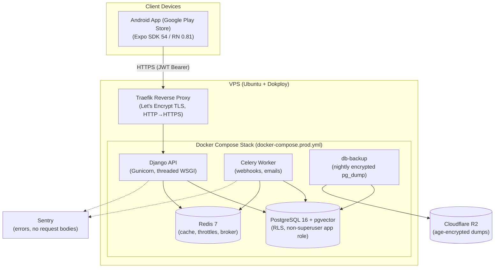

# Deployment & Google Play Store Publishing Guide

This guide covers deploying the **Happy Women** backend on a VPS with **Docker & Dokploy**, and publishing the Android app to the **Google Play Store**.

---

## 1. Architecture Overview



The API container publishes **no host port**. Traefik reaches it over `dokploy-network`, so the only public entry is HTTPS through Traefik.

---

## 2. Backend Deployment on VPS (Docker & Dokploy)

Dokploy is an open-source, self-hosted PaaS with a built-in Traefik reverse proxy and automated TLS certificates.

### Step 2.1: Install Dokploy on your VPS (if not installed)

On a fresh Ubuntu 22.04 or 24.04 LTS server:

```bash
curl -sSL https://dokploy.com/install.sh | sh
```

Open `http://<YOUR_VPS_IP>:3000` once to create the admin account, then **immediately** do Step 2.7 (the dashboard must not stay on plain HTTP on a public port).

---

### Step 2.2: Configure DNS Records

In your domain registrar / Cloudflare:

- Add an `A` record pointing your backend domain (e.g. `api.yourdomain.com`) to your VPS IP address.
- _(If using Cloudflare, set proxy status to **DNS Only** (grey cloud). If you later turn the orange-cloud proxy on, set `DRF_NUM_PROXIES=2` so rate limits still key on the real client IP.)_

---

### Step 2.3: Deploy via Dokploy Compose

1. In the Dokploy Dashboard, click **Create Project** (e.g., `happy-women`).
2. Click **Create Service** and choose **Compose**.
3. Under **Source**, connect the GitHub repository, select the release branch, and set the Compose Path to `docker-compose.prod.yml`.
4. Under the **Environment** tab, fill in the variables below.
5. Click **Deploy**.

#### Production Environment Variables Template

Mirrors `.env.production.example`. Required variables make the deploy fail fast if missing.

```env
DOMAIN=api.yourdomain.com
SECRET_KEY=generate_a_secure_random_key_with_at_least_50_chars
# Must include DOMAIN (the API healthcheck sends Host: $DOMAIN)
ALLOWED_HOSTS=api.yourdomain.com
CSRF_TRUSTED_ORIGINS=https://api.yourdomain.com
CORS_ALLOWED_ORIGINS=https://api.yourdomain.com
# Unguessable admin path, ending in "/": python -c "import secrets; print('ops-' + secrets.token_urlsafe(12) + '/')"
ADMIN_URL=ops-change-me/

# PostgreSQL
POSTGRES_DB=femtech
POSTGRES_USER=postgres
POSTGRES_PASSWORD=your_strong_postgres_password

# Application role for Row-Level Security (MUST NOT be superuser)
APP_DB_USER=femtech
APP_DB_PASSWORD=your_strong_femtech_app_password

# Tuning
GUNICORN_WORKERS=3
GUNICORN_THREADS=4
CELERY_LOG_LEVEL=info
CELERY_CONCURRENCY=2
LOG_LEVEL=INFO

# Public legal pages (/legal/privacy/, /legal/terms/, /legal/account-deletion/)
LEGAL_OPERATOR_NAME=Your Name or Company Ltd
SUPPORT_EMAIL=support@yourdomain.com
LEGAL_EFFECTIVE_DATE=1 November 2026

# Password-reset email (Resend). See "Transactional email" below.
RESEND_API_KEY=
DEFAULT_FROM_EMAIL=Happy Women <no-reply@yourdomain.com>

# Error reporting
SENTRY_DSN=
SENTRY_ENVIRONMENT=production
SENTRY_TRACES_SAMPLE_RATE=0

# RevenueCat (optional while v1 ships free; the webhook answers 401 until set)
REVENUECAT_SECRET_API_KEY=
REVENUECAT_WEBHOOK_AUTHORIZATION=
REVENUECAT_REQUEST_TIMEOUT_SECONDS=5

# Backups (see Step 2.6)
BACKUP_AGE_RECIPIENT=age1...
BACKUP_S3_ENDPOINT=https://<account-id>.r2.cloudflarestorage.com
BACKUP_S3_ACCESS_KEY_ID=
BACKUP_S3_SECRET_ACCESS_KEY=
BACKUP_BUCKET=happy-women-backups
BACKUP_PREFIX=postgres
BACKUP_KEEP_DAYS=30
```

In the Sentry project, enable **Settings → Security & Privacy → Prevent Storing of IP Addresses**; the privacy policy says crash reports carry no IP address.

Optional overrides: `API_DOCS_ENABLED=true` serves `/api/schema/` and `/api/docs/` (off in production by default), `JWT_ACCESS_MINUTES` (default 15; use `1` on staging to exercise token refresh), `DRF_NUM_PROXIES` (default 1).

#### Transactional email (password reset)

Password-reset emails go out through [Resend](https://resend.com) from the Celery worker.

1. In Resend, add and verify your sending domain (it gives you SPF/DKIM DNS records; add them at your DNS provider). Until the domain verifies, Resend only delivers to your own address.
2. Create an API key with **Sending access** only, scoped to that domain, and set it as `RESEND_API_KEY`.
3. Set `DEFAULT_FROM_EMAIL` to an address on the verified domain.

The email links to `https://<DOMAIN>/accounts/password-reset/...`, a page served by the API where the user picks a new password. Every refresh token for that user is then revoked, so all devices are signed out.

> [!IMPORTANT]
> **Row-Level Security (RLS) Requirement:**
> The database initialization script (`infra/initdb/01-init.sh`) automatically provisions the `femtech` role with `NOSUPERUSER NOBYPASSRLS`. PostgreSQL superusers bypass RLS even with `FORCE RLS` enabled, so the Django API connects as the `femtech` role to ensure strict multi-tenant data isolation.

---

### Step 2.4: Domain & HTTPS

Routing is defined by the Traefik labels on the `api` service in `docker-compose.prod.yml` (versioned with the stack): an HTTPS router on `websecure` with the `letsencrypt` resolver, and an HTTP router on `web` that only redirects to HTTPS.

**Do not also add a domain for this service in Dokploy's Domains UI.** Two definitions for the same host fight over the route.

---

### Step 2.5: Initial Setup & Superuser Creation

Once deployed, open the terminal in Dokploy (or SSH into your VPS) to create your Django superuser:

```bash
docker compose -f docker-compose.prod.yml exec api uv run manage.py createsuperuser
```

Verify your deployment:

- Health: `https://api.yourdomain.com/health/` returns `{"status": "ok"}`
- Django Admin: `https://api.yourdomain.com/<ADMIN_URL>`
- `https://api.yourdomain.com/api/docs/` returns 404 (docs are off in production)

---

### Step 2.6: Backups & restore

The `db-backup` service (`infra/backup/`) runs `pg_dump` once at start and then every `BACKUP_INTERVAL_SECONDS` (default 24h). Each dump is encrypted with [age](https://age-encryption.org) to a **public key**, uploaded to R2, and dumps older than `BACKUP_KEEP_DAYS` are pruned. A failed dump never leaves a partial object behind.

**One-time setup**

1. Generate the key pair **on your own machine, not the VPS**:
   ```bash
   age-keygen -o happy-women-backup.key
   # no local age? docker run --rm -v "$PWD:/out" alpine:3.20 sh -c "apk add -q age && age-keygen -o /out/happy-women-backup.key"
   ```
   It prints `Public key: age1...`. Put that in `BACKUP_AGE_RECIPIENT`.
2. Store `happy-women-backup.key` (the private key) in your password manager, then delete the local file. **Without it no backup can be restored. It must never be on the VPS.**
3. In Cloudflare R2, create a private bucket (`BACKUP_BUCKET`) and an API token scoped to **Object Read & Write on that bucket only**. Use its access key and secret for `BACKUP_S3_ACCESS_KEY_ID` / `BACKUP_S3_SECRET_ACCESS_KEY`, and the account's S3 endpoint for `BACKUP_S3_ENDPOINT`.
4. Deploy, then check: `docker compose -f docker-compose.prod.yml logs db-backup` shows `[backup] done`, and the object appears in the bucket.

**Take a backup now** (e.g. before a risky migration):

```bash
docker compose -f docker-compose.prod.yml exec db-backup backup.sh once
```

**Restore runbook** (run where the private key is available, e.g. your workstation or a fresh VPS):

1. Download the dump from R2 (dashboard or `rclone copy`).
2. Create an empty target database **owned by the app role** so ownership, grants and RLS policies come back exactly:
   ```bash
   psql -U postgres -c "CREATE DATABASE femtech_restore OWNER femtech"
   ```
3. Decrypt and restore **as the superuser, without `--no-owner`** (that flag would hand every table to `postgres` and change how RLS applies to the app role):
   ```bash
   age --decrypt --identity happy-women-backup.key femtech-<timestamp>.dump.age \
     | pg_restore --username postgres --dbname femtech_restore --exit-on-error
   ```
4. Sanity-check: row counts match expectations, `select count(*) from pg_policies` is non-zero, and as the `femtech` role with no `app.user_id` set, `select count(*) from cycles_cycle` returns 0 (RLS still fails closed).
5. Point `DATABASE_URL` at the restored database (or rename it to `femtech`) and redeploy.

**Restore drill:** do steps 1–4 against a throwaway Postgres container before launch and then quarterly. A backup you have never restored is a hope, not a backup.

---

### Step 2.7: VPS hardening

- **Docker-published ports bypass `ufw`.** `ufw deny 3000` does not stop Docker from serving a published port, so do not rely on the firewall alone.
- Give the Dokploy dashboard its own domain with HTTPS (Dokploy → Settings → Server/Web domain), then stop exposing `:3000` publicly (Dokploy settings, or bind it to localhost / reach it over SSH tunnel or Tailscale).
- From another machine, `nmap -p- <VPS_IP>` should show only 22, 80 and 443. `curl http://<VPS_IP>:8000/` must be refused.
- SSH: key-only auth, `PermitRootLogin no`, and unattended security upgrades.

---

## 3. Google Play Store Preparation & Publishing

### Step 3.1: Play Store Compliance for Health Apps

Google Play has strict requirements for apps handling sensitive reproductive health and menstrual tracking data:

1. **Privacy Policy**:
   - Must have an active, publicly accessible HTTPS URL. The API serves it at `https://api.yourdomain.com/legal/privacy/`.
   - Must clearly disclose that the app collects personal health information (cycles, symptoms, dates) and how it is protected.
2. **Health Apps Declaration (Google Play Policy)**:
   - In Google Play Console under **Policy > App Content > Health Apps**, declare the app's health features (menstrual cycle tracking, pregnancy tracking).
   - Declare that user data is encrypted in transit (HTTPS / TLS).
3. **Data Safety Section**: health info, email and crash diagnostics are collected, nothing is shared or sold, data is encrypted in transit, and users can request deletion.
4. **Account deletion**: in-app (Settings → Delete account) **and** a web URL: `https://api.yourdomain.com/legal/account-deletion/`.
5. **Target Audience**: 18+.

---

### Step 3.2: Mobile App Production Configuration

1. EAS builds run with `EXPO_NO_DOTENV=1`, so every variable from `apps/mobile/.env.production.example` must exist as an EAS environment variable for `production`:

```env
API_URL=https://api.yourdomain.com/api/v1/
AMPLITUDE_API_KEY=
PRIVACY_POLICY_URL=https://api.yourdomain.com/legal/privacy/
TERMS_URL=https://api.yourdomain.com/legal/terms/
SUPPORT_EMAIL=support@yourdomain.com
REVENUECAT_ANDROID_API_KEY=
SENTRY_DSN=
SENTRY_ORG=
SENTRY_PROJECT=
```

```bash
cd apps/mobile
eas env:create --environment production --name API_URL --value https://api.yourdomain.com/api/v1/ --visibility plaintext
# ...repeat per variable. SENTRY_AUTH_TOKEN is a secret: --visibility secret
```

Source maps upload to Sentry only when the `SENTRY_AUTH_TOKEN` secret is present; builds without it still succeed.

2. Update identity in `apps/mobile/env.js`:
   - `EXPO_ACCOUNT_OWNER`: your Expo account or organization.
   - `EAS_PROJECT_ID`: the UUID printed by `npx eas project:init` (run inside `apps/mobile`).
   - Confirm `PACKAGE = "com.happywomen.app"`.

---

### Step 3.3: Generating the Production Android App Bundle (.aab)

Google Play requires the **Android App Bundle (`.aab`)** format.

#### Option A: EAS Cloud Build (Recommended)

```bash
# 1. Login to Expo (if not already logged in)
pnpm mobile dlx eas-cli login

# 2. Link your EAS project (run once)
cd apps/mobile && npx eas project:init

# 3. Trigger production Android build
pnpm mobile build:production:android
```

EAS will:

- Automatically manage your Android keystore / signing credentials.
- Build the `.aab` bundle with Proguard / minification.
- Automatically increment the `versionCode`.

#### Option B: Local Android Release Build (No EAS Account Required)

```bash
# 1. Generate native Android project with production environment
cd apps/mobile
cross-env APP_ENV=production EXPO_NO_DOTENV=1 pnpm run prebuild:production

# 2. Build the signed Release AAB bundle via Gradle
cd android
./gradlew bundleRelease
```

The output will be generated at:
`apps/mobile/android/app/build/outputs/bundle/release/app-release.aab`.

---

### Step 3.4: Google Play Console Release Flow

1. **Create App in Google Play Console**:
   - App Name: `Happy Women`
   - Default language: English (United States)
   - App or game: App
   - Free or paid: Free
2. **Complete Store Presence**:
   - **App icon**: 512 x 512 px (PNG, up to 1 MB).
   - **Feature graphic**: 1024 x 500 px (PNG or JPEG).
   - **Phone screenshots**: At least 2 screenshots (min 320 px, max 3840 px, 16:9 or 9:16 aspect ratio).
3. **Internal Testing Track**:
   - Go to **Testing > Internal testing**.
   - **Upload the first `.aab` by hand in the Play Console.** The Play API that `eas submit` uses cannot create an app's first release; after that, `eas submit -p android --profile production` works.
   - Add your email and internal team members as testers to verify installation and login against your live VPS backend.
4. **Closed Testing Track (20 Testers)**:
   - For personal developer accounts created after November 13, 2023, Google requires **20 opted-in testers for at least 14 days** continuously before applying for Production access. Start this as early as possible; it is the longest step.
5. **Production Release**:
   - After the closed test period, apply for production access in the Play Console dashboard.
   - Promote your tested build from Closed Testing to **Production**.

---

## 4. Verification Checklist

| Step        | Item                                                                                                                | Status |
| :---------- | :------------------------------------------------------------------------------------------------------------------ | :----: |
| **Backend** | Docker image builds with Python 3.12 and `uv`; runs as non-root                                                     |  [ ]   |
| **Backend** | PostgreSQL initialized with `pgvector` and non-superuser `femtech` role                                             |  [ ]   |
| **Backend** | `/health/` returns 200 over HTTPS; `/api/docs/` returns 404                                                         |  [ ]   |
| **Backend** | `curl http://<VPS_IP>:8000/` refused; `nmap` shows only 22/80/443                                                   |  [ ]   |
| **Backend** | 11 bad logins in a minute return 429; another client IP is unaffected                                               |  [ ]   |
| **Backend** | Sentry receives a test event (`manage.py shell -c "import sentry_sdk; sentry_sdk.capture_message('deploy check')"`) |  [ ]   |
| **Backend** | `db-backup` logged `[backup] done`; object present in R2                                                            |  [ ]   |
| **Backend** | Restore drill completed against a throwaway database                                                                |  [ ]   |
| **Mobile**  | `pnpm check-all` passes                                                                                             |  [ ]   |
| **Mobile**  | `env.js` has the real `EAS_PROJECT_ID` and owner                                                                    |  [ ]   |
| **Mobile**  | Production EAS env vars set, including `SENTRY_AUTH_TOKEN` secret                                                   |  [ ]   |
| **Store**   | Privacy policy, terms and account-deletion URLs load over HTTPS                                                     |  [ ]   |
