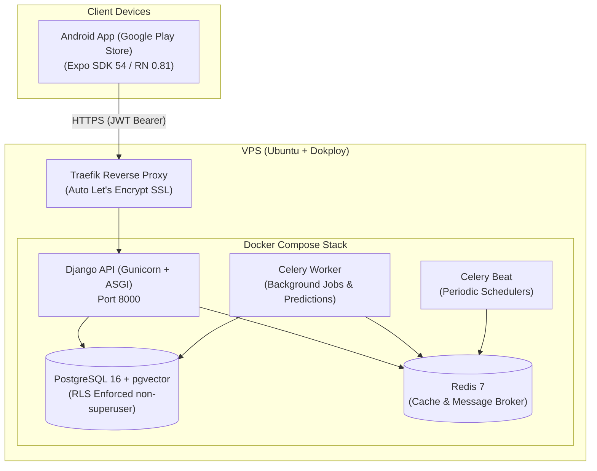

# Deployment & Google Play Store Publishing Guide

This guide covers the complete end-to-end process for deploying the **Happy Women** backend on a VPS using **Docker & Dokploy**, and publishing the mobile application to the **Google Play Store**.

---

## 1. Architecture Overview



---

## 2. Backend Deployment on VPS (Docker & Dokploy)

Dokploy is an open-source, self-hosted PaaS with built-in Traefik reverse proxy and automated SSL certificates.

### Step 2.1: Install Dokploy on your VPS (if not installed)
On a fresh Ubuntu 22.04 or 24.04 LTS server:
```bash
curl -sSL https://dokploy.com/install.sh | sh
```
Once installed, navigate to `http://<YOUR_VPS_IP>:3000` to set up your admin credentials.

---

### Step 2.2: Configure DNS Records
In your domain registrar / Cloudflare:
- Add an `A` record pointing your backend domain (e.g. `api.yourdomain.com`) to your VPS IP address.
- *(If using Cloudflare, set proxy status to **DNS Only** (Grey Cloud) initially to let Let's Encrypt issue the SSL certificate smoothly).*

---

### Step 2.3: Deploy via Dokploy Compose

Dokploy provides native **Docker Compose** support, allowing you to manage the API, PostgreSQL (with pgvector and RLS), Redis, and Celery workers as a unified stack.

1. In the Dokploy Dashboard, click **Create Project** (e.g., `happy-women`).
2. Click **Create Service** and choose **Compose**.
3. Under **Source**:
   - **Option A (GitHub Repository)**: Connect your repository, select the `main` branch, and set the Compose Path to `docker-compose.prod.yml`.
   - **Option B (Raw Compose)**: Copy the contents of `docker-compose.prod.yml` directly into the Dokploy Compose editor.
4. Under the **Environment** tab, fill in the production environment variables (see template below).
5. Click **Deploy**.

#### Production Environment Variables Template
Copy from `.env.production.example`:

```env
DOMAIN=api.yourdomain.com
SECRET_KEY=generate_a_secure_random_key_with_at_least_50_chars
ALLOWED_HOSTS=api.yourdomain.com,localhost
CSRF_TRUSTED_ORIGINS=https://api.yourdomain.com
CORS_ALLOWED_ORIGINS=https://api.yourdomain.com

# PostgreSQL
POSTGRES_DB=femtech
POSTGRES_USER=postgres
POSTGRES_PASSWORD=your_strong_postgres_password

# Application role for Row-Level Security (MUST NOT be superuser)
APP_DB_USER=femtech
APP_DB_PASSWORD=your_strong_femtech_app_password

# Tuning
GUNICORN_WORKERS=3
API_PORT=8000
CELERY_LOG_LEVEL=info
CELERY_CONCURRENCY=2
```

> [!IMPORTANT]
> **Row-Level Security (RLS) Requirement:**
> The database initialization script (`infra/initdb/01-init.sh`) automatically provisions the `femtech` role with `NOSUPERUSER NOBYPASSRLS`. PostgreSQL superusers bypass RLS even with `FORCE RLS` enabled, so the Django API connects as the `femtech` role to ensure strict multi-tenant data isolation.

---

### Step 2.4: Domain & HTTPS Setup in Dokploy
1. In Dokploy under your Compose service, select the `api` service.
2. In the **Domains** section:
   - **Host:** `api.yourdomain.com`
   - **Port:** `8000`
   - **HTTPS:** Enabled (Let's Encrypt)
   - **Certificate:** Automated Let's Encrypt
3. Click **Save** and **Deploy**.

---

### Step 2.5: Initial Setup & Superuser Creation
Once deployed, open the terminal in Dokploy (or SSH into your VPS) to create your Django superuser:

```bash
# SSH into your VPS, or run from Dokploy terminal:
docker compose -f docker-compose.prod.yml exec api uv run manage.py createsuperuser
```

Verify your deployment:
- API OpenAPI Docs: `https://api.yourdomain.com/api/schema/swagger-ui/`
- Django Admin: `https://api.yourdomain.com/admin/`

---

## 3. Google Play Store Preparation & Publishing

### Step 3.1: Play Store Compliance for Health Apps

Google Play has strict requirements for apps handling sensitive reproductive health and menstrual tracking data:

1. **Privacy Policy**:
   - Must have an active, publicly accessible HTTPS URL (e.g., `https://yourdomain.com/privacy`).
   - Must clearly disclose that the app collects personal health information (cycles, symptoms, dates) and how it is protected.
2. **Health Apps Declaration (Google Play Policy)**:
   - In Google Play Console under **Policy > App Content > Health Apps**, declare that your app falls under **Health & Fitness > Women's Health & Cycle Tracking**.
   - Declare that user data is encrypted in transit (HTTPS / TLS).
3. **Data Safety Section**:
   - **Data Collected**: Health info (cycle tracking, symptoms, dates), Personal info (Email address).
   - **Data Sharing**: Not shared with third parties for advertising or tracking.
   - **Data Deletion**: Must provide an in-app option or web link for users to request account and data deletion.
4. **Target Audience**:
   - Select 18+ (or 13+ depending on your target audience; selecting under 13 requires complying with Google Play Families Policy).

---

### Step 3.2: Mobile App Production Configuration

1. In `apps/mobile`, create your production environment configuration by copying `apps/mobile/.env.production.example` to `.env.production`:

```env
API_URL=https://api.yourdomain.com/api/
AMPLITUDE_API_KEY=
PRIVACY_POLICY_URL=https://yourdomain.com/privacy
TERMS_URL=https://yourdomain.com/terms
SUPPORT_EMAIL=support@yourdomain.com
```

2. If using **EAS (Expo Application Services)**, ensure these variables are added to your EAS dashboard or uploaded via CLI:
```bash
eas env:create production --from-file apps/mobile/.env.production
```

3. Update identity in `apps/mobile/env.js`:
   - Ensure `EAS_PROJECT_ID` has your actual Expo project UUID (obtain by running `npx eas project:init` inside `apps/mobile`).
   - Confirm `PACKAGE = "com.happywomen.app"`.

---

### Step 3.3: Generating the Production Android App Bundle (.aab)

Google Play requires the **Android App Bundle (`.aab`)** format.

#### Option A: EAS Cloud Build (Recommended)
From the repo root:
```bash
# 1. Login to Expo (if not already logged in)
pnpm mobile dlx eas-cli login

# 2. Link your EAS project (run once)
cd apps/mobile && npx eas project:init

# 3. Trigger production Android build
pnpm mobile build:production:android
```
EAS will:
- Automatically manage your Android keystore / signing credentials.
- Build the `.aab` bundle with Proguard / minification.
- Automatically increment the `versionCode`.

#### Option B: Local Android Release Build (No EAS Account Required)
If you prefer to build locally on your own machine without waiting in EAS cloud queues:
```bash
# 1. Generate native Android project with production environment
cd apps/mobile
cross-env APP_ENV=production EXPO_NO_DOTENV=1 pnpm run prebuild:production

# 2. Build the signed Release AAB bundle via Gradle
cd android
./gradlew bundleRelease
```
The output will be generated at:
`apps/mobile/android/app/build/outputs/bundle/release/app-release.aab`.

---

### Step 3.4: Google Play Console Release Flow

1. **Create App in Google Play Console**:
   - App Name: `Happy Women`
   - Default language: English (United States)
   - App or game: App
   - Free or paid: Free
2. **Complete Store Presence**:
   - **App icon**: 512 x 512 px (PNG, up to 1 MB).
   - **Feature graphic**: 1024 x 500 px (PNG or JPEG).
   - **Phone screenshots**: At least 2 screenshots (min 320 px, max 3840 px, 16:9 or 9:16 aspect ratio).
3. **Internal Testing Track**:
   - Go to **Testing > Internal testing**.
   - Create a new release and upload your `app-release.aab`.
   - Add your email and internal team members as testers to verify installation and login against your live VPS backend.
4. **Closed Testing Track (20 Testers)**:
   - For personal developer accounts created after November 13, 2023, Google requires **20 opted-in testers for at least 14 days** continuously before applying for Production access.
   - Invite 20 testers on the Closed Testing track.
5. **Production Release**:
   - After the closed test period, apply for production access in the Play Console dashboard.
   - Promote your tested build from Closed Testing to **Production**.

---

## 4. Verification Checklist

| Step | Item | Status |
| :--- | :--- | :---: |
| **Backend** | Docker container builds cleanly with Python 3.12 and `uv` | [x] Ready |
| **Backend** | PostgreSQL initialized with `pgvector` and non-superuser `femtech` role | [x] Ready |
| **Backend** | `WhiteNoise` enabled for static files (Django admin & Swagger assets) | [x] Ready |
| **Backend** | `CSRF_TRUSTED_ORIGINS` & `ALLOWED_HOSTS` dynamically loaded from `.env` | [x] Ready |
| **Backend** | Dokploy Traefik labels configured for automated HTTPS / Let's Encrypt | [x] Ready |
| **Mobile** | Type-checking passes with 0 errors (`pnpm --filter mobile type-check`) | [x] Ready |
| **Mobile** | `app.config.ts` has `versionCode` and blocked sensitive permissions | [x] Ready |
| **Mobile** | `env.js` validates `API_URL` uses HTTPS in production | [x] Ready |
| **Mobile** | `eas.json` production profile configured for `app-bundle` (`.aab`) | [x] Ready |
